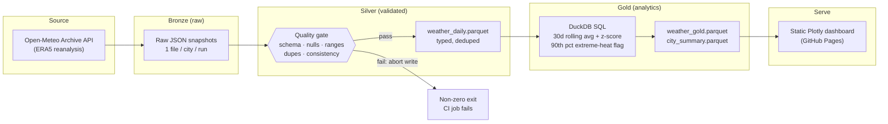
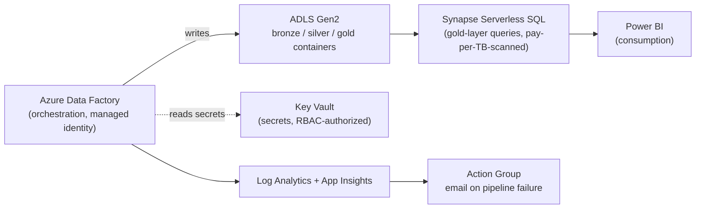

# AU Weather Medallion Pipeline

[](https://github.com/vabhishek8/azure-medallion-weather-pipeline/actions/workflows/pipeline.yml)

Daily weather for the five largest Australian capital cities, run through a bronze, silver and gold pipeline on a real schedule. It pulls from Open-Meteo, checks the data at a quality gate, works out rolling anomalies in DuckDB SQL, and publishes a static dashboard.

**[Live dashboard →](https://vabhishek8.github.io/azure-medallion-weather-pipeline/)**

## Why I built it

Most portfolio ETL projects load a CSV, run a query and stop. That doesn't show much. I wanted something that runs every day whether I'm watching or not, so I'd have to deal with the parts that make a pipeline hard to trust:

- the upstream API returning partial data for one city and not the others
- who decides when raw data becomes trusted, and what happens when it shouldn't
- which logic belongs in SQL and which belongs in application code
- what this would cost to run properly in Azure, and how to stop it costing more than it should

## How it's wired



A GitHub Actions workflow runs it daily, on every push to `main`, and on demand. The test job runs first, and the pipeline job only starts if the tests pass. If the quality gate or the API call fails, the run fails and nothing downstream carries on with bad data.

## What broke, and how it got caught

I started on Open-Meteo's forecast endpoint, using its `past_days` parameter. Past a short lookback, it returns sparse or null daily values for humidity and a few other fields. The null check in `src/quality_checks.py` flagged it on the first runs. The warnings were right, so I changed the source rather than loosening the check. Bronze now pulls from the archive endpoint (ERA5 reanalysis), which returns complete daily values with roughly a one-day lag. That's why ingestion always asks for data up to yesterday, not today.

The quality gate runs before every silver write:

- every required column is present
- nulls in `city` or `date` are errors, and nulls anywhere else are warnings
- each field stays inside physically plausible bounds
- no duplicate `(city, date)` rows
- the maximum temperature is never below the minimum

If an error-level check fails, the write is aborted with a structured report, and nothing reaches gold.

## Gold layer

DuckDB SQL over the silver Parquet file. It's the same execution model as querying ADLS Gen2 through Synapse Serverless SQL.

- `temp_anomaly_c` and `temp_anomaly_zscore`: distance from a 30-day trailing mean and standard deviation, as window functions
- `is_extreme_heat`: maximum temperature at or above the 95th percentile of the trailing 90 days
- `rain_flag`: a wet or dry day
- a city summary: averages, peaks and the count of extreme-heat days

## The Azure version, and why it isn't running

This runs on GitHub Actions and DuckDB because that's free and right-sized for five cities and one row per city per day. `infra/main.bicep` is the same design written for a governed Azure estate:



The calls I made, and why:

| Decision | Reasoning |
|---|---|
| Synapse **serverless** SQL, not a dedicated pool | Dedicated pools bill hourly regardless of load, indefensible for a low-volume workload. Serverless bills per TB scanned. |
| Managed identity + RBAC, no shared keys/connection strings | ADF and Synapse get `Storage Blob Data Contributor` scoped to one storage account, nothing broader. Secrets live in Key Vault, not pipeline JSON. |
| `Standard_LRS` in dev, `Standard_ZRS` in prod | Zone-redundant storage is a prod-only cost; dev doesn't need it. |
| Not deployed and left running | A standing ADF + Synapse estate for a 5-row/day dataset has real, ongoing cost with no proportional benefit. Deploy on demand, validate, tear down: the template is the deliverable, not a permanently running resource. |
| Metric alert on `PipelineFailedRuns` → email | A failed pipeline that nobody notices until a dashboard looks stale is a monitoring gap, not just a missing feature. |

Validated with `bicep build` (0 errors). To deploy it yourself:

```bash
az deployment group create \
  --resource-group rg-weather-pipeline-dev \
  --template-file infra/main.bicep \
  --parameters environment=dev alertEmail=you@example.com
```

## Running it locally

```bash
python -m venv .venv && source .venv/bin/activate
pip install -r requirements.txt
python src/pipeline.py          # bronze -> silver -> gold -> dashboard
PYTHONPATH=src pytest tests/ -v # 15 tests: quality gate, transform, gold SQL
open docs/index.html
```

## Repo layout

```
src/
  ingest.py          bronze: Open-Meteo archive API, retry + partial-failure handling
  transform.py        silver: parse + validate + dedupe
  quality_checks.py   the quality gate (schema/nulls/ranges/dupes/consistency)
  gold.py              gold: DuckDB SQL, rolling anomaly detection
  dashboard.py         renders gold -> static Plotly HTML
  pipeline.py           orchestrates all four stages
tests/                 15 pytest cases covering the gate, transform, and SQL logic
infra/main.bicep       production Azure IaC (ADF, ADLS Gen2, Synapse, Key Vault, monitoring)
.github/workflows/     scheduled CI: test -> run -> commit refreshed gold data
```

## Stack

Python, pandas, DuckDB, Plotly, pytest and GitHub Actions. The Bicep covers Azure Data Factory, ADLS Gen2, Synapse Serverless SQL, Key Vault, Log Analytics and Application Insights.

---

Built by [Abhishek Vadlamudi](https://abhishekvadlamudi.com), Senior Business Intelligence Engineer at Unisys in Sydney.
